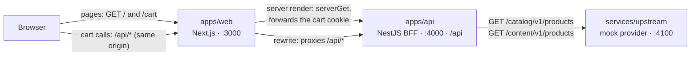
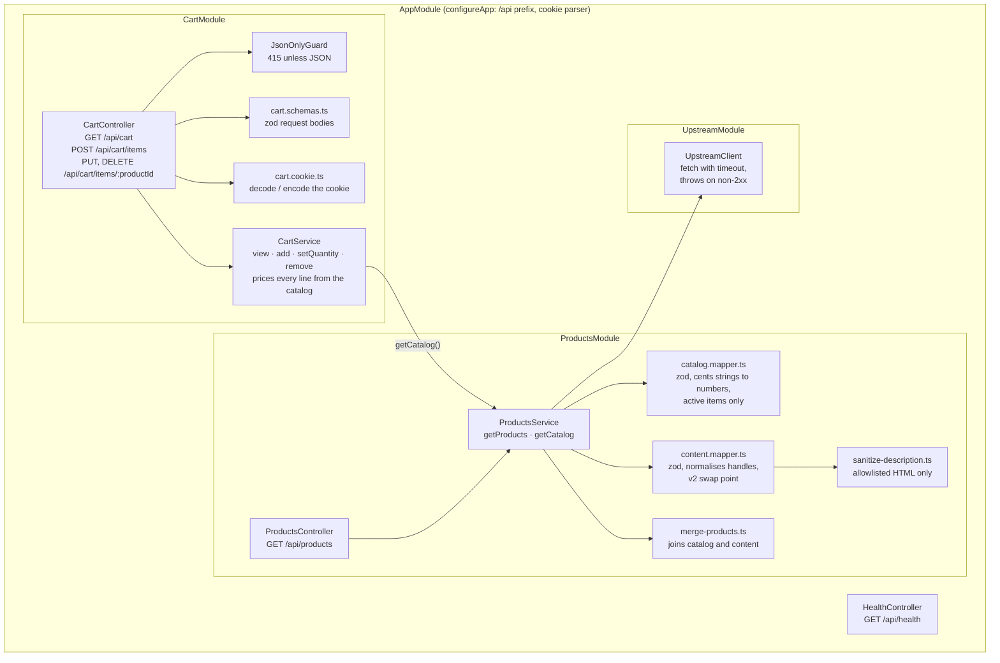
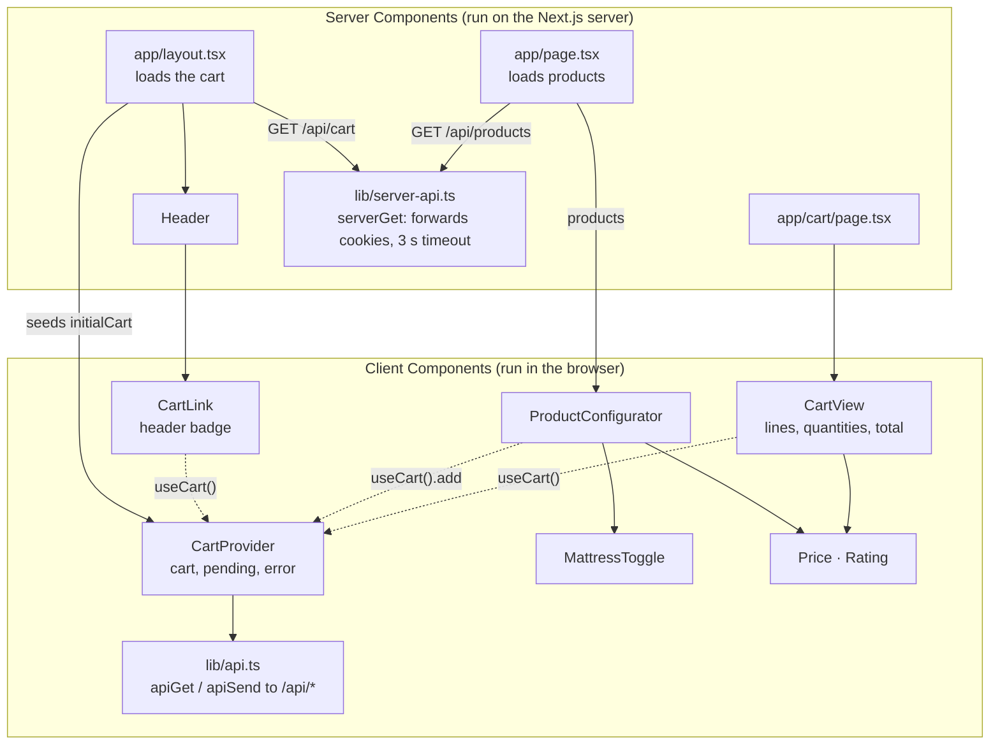
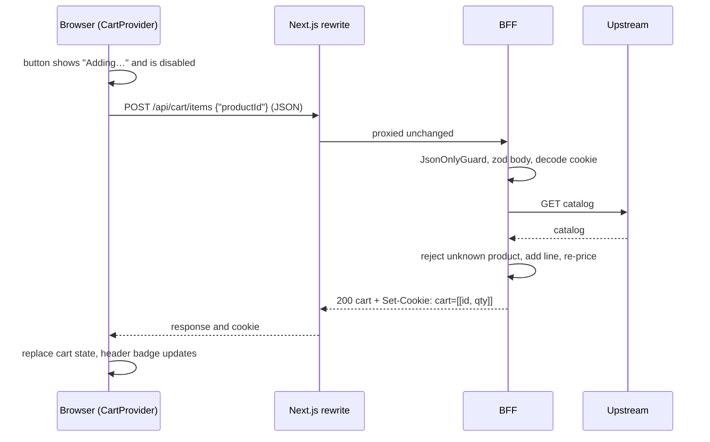

# Architecture

How the app works and which modules are involved. It describes the code as built; the decisions behind it are in [00-overview.md](00-overview.md). The diagrams are Mermaid, which GitHub renders inline.

## 1. The three processes



- The browser only ever talks to the web origin. Cart calls use relative `/api/*` URLs, which `next.config.mjs` proxies to the BFF, so the `cart` cookie the BFF sets lands on the web origin.
- Server Components can't use that rewrite, so `lib/server-api.ts` calls the BFF directly and forwards the incoming request's cookies.
- Only the BFF knows the upstream exists. The web app sees one product shape and one cart shape, both owned by the BFF (D11).

## 2. BFF modules (`apps/api`)



- **Products:** catalog and content are fetched in parallel. The catalog decides which products exist and what they cost; content only adds the headline, description and rating. If content fails, products are still served with those fields `null`. If the catalog fails, the response is 503.
- **Cart:** the cookie holds only `[[productId, quantity]]`. Every request decodes it defensively (garbage becomes an empty cart, quantities are clamped to 1–10), re-prices it from the live catalog, drops lines for products that no longer exist and writes the cookie back when it changed. No price is ever read from the cookie.
- **Upstream quirks** (string prices, discontinued items, handle casing, string ratings, untrusted HTML) are all handled in the two mappers, so nothing upstream-shaped reaches the controllers.

## 3. Web modules (`apps/web`)



- The layout loads the cart on the server, so the header count is right in the first HTML (no flash of 0) and the `/cart` page needs no fetch of its own.
- `CartProvider` is the single client-side owner of the cart. Every mutation goes through it; it ignores a second click while one is in flight and replaces its state with the cart the BFF returns.
- Styling is plain CSS in `app/globals.css`.

## 4. Loading a page

```mermaid
sequenceDiagram
  participant B as Browser
  participant W as Next.js server
  participant A as BFF
  participant U as Upstream

  B->>W: GET / (sends cart cookie)
  par layout
    W->>A: GET /api/cart (cookie forwarded)
    A->>U: GET catalog
    U-->>A: catalog
    A-->>W: priced cart
  and page
    W->>A: GET /api/products
    par
      A->>U: GET catalog
    and
      A->>U: GET content
    end
    U-->>A: catalog and content
    A-->>W: merged products
  end
  W-->>B: HTML with the header count and the configurator
  Note over B: React hydrates; CartProvider starts from the server cart
```

An empty cart cookie skips the catalog call entirely. If the products request fails, the page shows a friendly message instead of the configurator; if the cart request fails, the header shows no count and the rest of the page still renders.

## 5. Adding to the cart



Changing a quantity (`PUT`) and removing a line (`DELETE`) follow the same path from the cart page. If the catalog is down, the BFF answers 503 "Cart is temporarily unavailable" and the cookie is left as it was.
